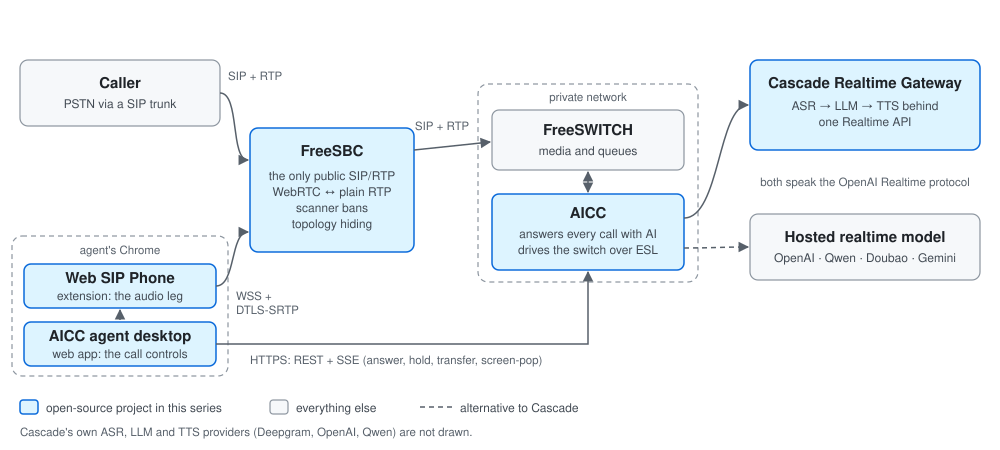

Call a support line and the call usually goes like this. A recording reads
you a menu. You press 3, then 1, then 0 because nothing fits. You wait in a
queue. An agent picks up and asks for the order number you already keyed
into the menu.

Behind that call there is more pain, just not the caller's:

- The agent's desktop softphone has to be installed, configured and kept
  registered. When a laptop sleeps, the agent is silently unreachable.
- The PBX is either on the public internet, where it is scanned all night,
  or behind a session border controller that costs real money.
- If a voice bot has been bolted onto the front, it is wired to one vendor's
  API, and it hands the caller to a person with none of what was said.

Each of those pains sits on a different boundary of the call path: the
public edge, the switch, the model, and the agent's browser. I built one
open-source project per boundary. This post is the map; later posts take
one problem at a time.

## One call, end to end

1. A caller dials in. The carrier's SIP reaches **FreeSBC**, the only host
   with a public address, and FreeSBC relays it to FreeSWITCH on a private
   network.
2. FreeSWITCH hands the call to **AICC**, which answers it with a realtime
   voice model. AICC speaks the OpenAI Realtime protocol, either to a hosted
   model (OpenAI, Qwen, Doubao, Gemini) or to **Cascade Realtime Gateway**,
   which runs ASR → LLM → TTS behind the same protocol.
3. The model talks; a flow decides the phase and when a person is needed.
   When one is, AICC moves the caller into a `mod_callcenter` queue together
   with a summary of the conversation so far.
4. An agent's phone rings. The phone is **Web SIP Phone**, a Chrome
   extension whose audio reaches FreeSWITCH through FreeSBC over WSS and
   DTLS-SRTP. The agent answers in the AICC web app; the extension has no
   answer button.
5. When the call ends, the bot phase, the queue wait and the agent's part
   are one record.

## The edge: FreeSBC

**The pain.** A SIP server with a public address gets found by scanners
and brute-forced, around the clock. Commercial SBCs fix that for a price. The
open-source route usually means assembling a SIP proxy, a separate media
relay and their configuration, which is a lot to own for one switch.

**The project.** FreeSBC's pitch is "the Caddy experience:
[one binary, one YAML file, `./freesbc run`][fsbc-pitch]". It is the only
element with a public address; FreeSWITCH or Asterisk
[stays on a private LAN and only ever talks to FreeSBC][fsbc-lan]. It is a
[stateful SIP proxy, not a B2BUA][fsbc-proxy], and it terminates ICE-Lite,
DTLS-SRTP and RTCP-mux for browsers so the switch
[only sees plain RTP][fsbc-webrtc]. The front door has
[per-IP rate limits and scanner fingerprinting][fsbc-shield], and an INVITE
is [admitted only from the exact transport address of a live registration,
or from a carrier][fsbc-admit].

**The boundary.** A feature belongs in FreeSBC only if
[only the edge can see or do it][fsbc-scope]. CPS limits, toll-fraud rules
and CDRs stay on the switch, which already does them well. That rule had a
cost: the whole trunk/B2BUA plane was
[deleted on 2026-10-02][fsbc-b2bua] because it failed the test. The same
discipline gives topology hiding by construction:
[every SDP body is built by FreeSBC, never copied from the other leg][fsbc-sdp].

**Not done yet.** Client legs are
[not fully topology-hidden][fsbc-hiding] (issues #166 and #167),
[IPv6 is untested][fsbc-ipv6], and there is
[no TURN or full ICE][fsbc-turn].

## The switch and the call: AICC

**The pain.** DTMF menus. Callers repeating themselves after a transfer.
One call split into an IVR log, a queue log and a recording. Dialplans
spread across XML files.

**The project.** AICC is
"[an open-source call center where the AI is the default answer, not an add-on][aicc-pitch]".
There is [no DTMF IVR][aicc-p4]: every external number answers with a bot
flow. "[The model owns the dialogue; the flow owns the phase.][aicc-flow]"

The handoff is a tool call. `transfer_to_agent`
[requires a queue, a reason and a summary][aicc-transfer], plus any slots
collected so far. The agent's screen-pop arrives as a `PARTY_RINGING` event
over SSE, and the bot-phase transcript is
[already there, because the call id is minted before any leg exists][aicc-pop].
The result is [one CDR with one transcript and one recording][aicc-cdr],
not three fragments.

On the switch side, FreeSWITCH
[reads its directory and its queues from PostgreSQL through Lua][aicc-db],
so adding an extension, a queue or a number is a database change. The
whole thing is [one Go binary plus PostgreSQL and FreeSWITCH][aicc-shape].

**The boundary.** A deployment runs
[exactly one provider, chosen at startup][aicc-providers], and a cascaded
ASR + LLM + TTS pipeline
[never enters this repository][aicc-a6]. Anything that speaks the Realtime
protocol can be plugged in instead, which is why the next project exists.

A taste of what this layer has to get right:
"[Turn end ≠ playback end.][aicc-turn]" The model finishing a response is
not the caller having heard it, so a transfer or a hangup
[waits for the audio to drain][aicc-drain]. That gets its own post.

## The model: Cascade Realtime Gateway

**The pain.** Speech-to-speech models are the easy path, but they tie you
to one vendor's voices, languages, regions and prices. Building your own
pipeline looks easy too, and isn't. In Cascade's README:
"[Wiring ASR → LLM → TTS together takes an afternoon. The rest of a voice agent is what takes months][crg-why]":
turn detection, barge-in, context after an interrupt, streaming, races, and
a stable client protocol.

**The project.** Cascade
[speaks the OpenAI Realtime (GA) WebSocket protocol to clients and runs a cascaded ASR → LLM → TTS pipeline behind it][crg-what].
The backend is a [named profile, changed at runtime through an Admin API][crg-profile];
new calls pick up the change and calls in progress don't notice. Providers
today are [Deepgram, OpenAI and Qwen][crg-providers]. Tools are declared by
the client and executed by the client, and a tool call
[is never handed to TTS][crg-tools], so the caller never hears JSON.

One number shows why "context after an interrupt" is on that list. In one
measured barge-in,
[10260 ms of audio had been generated and the caller had heard 2740 ms][crg-truncate].
Without trimming, 117 characters the caller never heard would have entered
the next turn's context.

On latency, the gateway itself
[adds 0.6 ms][crg-overhead] between the provider's first audio frame and
the client's. End of user speech to first playable audio was
[p50 1223 ms][crg-e2e] on 2026-09-01, measured from a machine in China
against a dedicated Qwen deployment over 20 turns; 391 ms of that is the
500 ms VAD silence window doing its job.

**The boundary.** Cascade [does not speak SIP or G.711][crg-scope]; audio is
24 kHz PCM in and out. The telephone side is AICC's job, which is why AICC
[resamples 8 kHz to 24 kHz and back][aicc-resample] when it talks to the
gateway. Cascade is also single-node:
[one static API key, no clustering, no persistence][crg-limits].

## The agent's ear: Web SIP Phone

**The pain.** A desktop softphone is one more thing to install and support.
A browser softphone tab has its own failures: refresh the page and the call
drops; close the laptop lid and the agent stays "available" while being
unreachable.

**The project.** Web SIP Phone is a Chrome extension, and
"[it is **not** a softphone][wsp-not]": all call control comes from the SIP
server, and the page's own softphone bar owns every call-facing button. Its
one job is to keep one agent's WebRTC SIP leg registered and healthy:

- The SIP runtime lives in an offscreen document, so
  [refreshing the page mid-call does not interrupt audio or change the Call-ID][wsp-f5].
  That was [checked live against FreeSWITCH on 2026-09-02][wsp-f5-live].
- A [10-second heartbeat][wsp-sleep] notices a gap of more than 90 seconds,
  which means the machine slept, and forces a reconnect.
- With AICC, [nobody configures it][wsp-zero]. Signing in mints SIP
  credentials and the web app hands them to the extension, as
  [a digest hash, never a plaintext password][wsp-hash].

## Where each pain is handled

| Pain | Handled by |
|---|---|
| PBX exposed to scanners and toll fraud | FreeSBC |
| One-way audio and dropped calls behind NAT | FreeSBC |
| Browsers (WebRTC) talking to a plain-RTP switch | FreeSBC |
| DTMF menus | AICC |
| Callers repeating themselves after a transfer | AICC |
| One call, three fragmented records | AICC |
| Dialplan and queue config sprawl | AICC |
| Locked into one speech-to-speech vendor | Cascade Realtime Gateway |
| Barge-in, turn detection and context after an interrupt | Cascade and AICC |
| Installing and supporting desktop softphones | Web SIP Phone |
| Agents dropping off on refresh, sleep or Wi-Fi changes | Web SIP Phone |

## Why four repositories

Each project has a written rule about what it refuses to do. FreeSBC
leaves anything the switch can do to the switch. AICC keeps the cascaded
pipeline out. Web SIP Phone's spec says
"[do not add a dial pad, contacts, call history, a CTI API][wsp-scope]".
Cascade does not do telephony.

Those refusals make the pieces usable on their own. FreeSBC can front any
FreeSWITCH or Asterisk. Cascade can serve any Realtime client. AICC runs
fine with a hosted model and no Cascade. The joints between them are
ordinary protocols: SIP and RTP, the OpenAI Realtime protocol, and a small
`postMessage` protocol between a web page and an extension.

## What I am not claiming yet

AICC
[publishes no performance figures][aicc-noperf], because its load tests
have not run. FreeSBC's capacity numbers are
[explicitly preliminary][fsbc-perf], and
[there has been no run against FreeSWITCH][fsbc-perf-fs]. Everything here
is single-node. When those numbers exist, they will get their own posts,
with the setup next to them.

## Coming up

- Turn end is not playback end: why a bot cuts off its own goodbye
- Barge-in is a truncation problem
- One whitespace cut Qwen TTS first audio from 1.05 s to 0.25 s
- Keeping a browser phone registered through sleep, Wi-Fi changes and F5
- Why FreeSBC is a proxy and not a B2BUA

Code: [AICC](https://github.com/rasonyang/ai-native-callcenter) · [FreeSBC](https://github.com/rasonyang/freesbc) · [Cascade Realtime Gateway](https://github.com/rasonyang/cascade-realtime-gateway) · [Web SIP Phone](https://github.com/rasonyang/web-sip-phone)

[fsbc-pitch]: https://github.com/rasonyang/freesbc/blob/8bbc4e6ddb9ce752d14c64fa7362145a303ead99/README.md#L3
[fsbc-lan]: https://github.com/rasonyang/freesbc/blob/8bbc4e6ddb9ce752d14c64fa7362145a303ead99/README.md#L8
[fsbc-proxy]: https://github.com/rasonyang/freesbc/blob/8bbc4e6ddb9ce752d14c64fa7362145a303ead99/docs/design.md#L14-L20
[fsbc-webrtc]: https://github.com/rasonyang/freesbc/blob/8bbc4e6ddb9ce752d14c64fa7362145a303ead99/README.md#L115
[fsbc-shield]: https://github.com/rasonyang/freesbc/blob/8bbc4e6ddb9ce752d14c64fa7362145a303ead99/README.md#L106
[fsbc-admit]: https://github.com/rasonyang/freesbc/blob/8bbc4e6ddb9ce752d14c64fa7362145a303ead99/docs/edge.md#L47
[fsbc-scope]: https://github.com/rasonyang/freesbc/blob/8bbc4e6ddb9ce752d14c64fa7362145a303ead99/README.md#L144-L156
[fsbc-b2bua]: https://github.com/rasonyang/freesbc/commit/c363f6e52afb5ca2ececcccac3a4879b792e8875
[fsbc-sdp]: https://github.com/rasonyang/freesbc/blob/8bbc4e6ddb9ce752d14c64fa7362145a303ead99/README.md#L105
[fsbc-hiding]: https://github.com/rasonyang/freesbc/blob/8bbc4e6ddb9ce752d14c64fa7362145a303ead99/docs/edge.md#L218
[fsbc-ipv6]: https://github.com/rasonyang/freesbc/blob/8bbc4e6ddb9ce752d14c64fa7362145a303ead99/docs/edge.md#L230
[fsbc-turn]: https://github.com/rasonyang/freesbc/blob/8bbc4e6ddb9ce752d14c64fa7362145a303ead99/README.md#L173
[fsbc-perf]: https://github.com/rasonyang/freesbc/blob/8bbc4e6ddb9ce752d14c64fa7362145a303ead99/docs/performance.md#L3-L5
[fsbc-perf-fs]: https://github.com/rasonyang/freesbc/blob/8bbc4e6ddb9ce752d14c64fa7362145a303ead99/docs/performance.md#L19

[aicc-pitch]: https://github.com/rasonyang/ai-native-callcenter/blob/86ec6e1d05be5dfdcd06d92a1b675a659a3fd76a/README.md#L3
[aicc-p4]: https://github.com/rasonyang/ai-native-callcenter/blob/86ec6e1d05be5dfdcd06d92a1b675a659a3fd76a/docs/phase1-decisions.md#L12
[aicc-flow]: https://github.com/rasonyang/ai-native-callcenter/blob/86ec6e1d05be5dfdcd06d92a1b675a659a3fd76a/README.md#L45-L46
[aicc-transfer]: https://github.com/rasonyang/ai-native-callcenter/blob/86ec6e1d05be5dfdcd06d92a1b675a659a3fd76a/internal/flow/builtin.go#L213-L222
[aicc-pop]: https://github.com/rasonyang/ai-native-callcenter/blob/86ec6e1d05be5dfdcd06d92a1b675a659a3fd76a/README.md#L55-L59
[aicc-cdr]: https://github.com/rasonyang/ai-native-callcenter/blob/86ec6e1d05be5dfdcd06d92a1b675a659a3fd76a/README.md#L68-L70
[aicc-db]: https://github.com/rasonyang/ai-native-callcenter/blob/86ec6e1d05be5dfdcd06d92a1b675a659a3fd76a/README.md#L98-L102
[aicc-shape]: https://github.com/rasonyang/ai-native-callcenter/blob/86ec6e1d05be5dfdcd06d92a1b675a659a3fd76a/README.md#L12-L13
[aicc-providers]: https://github.com/rasonyang/ai-native-callcenter/blob/86ec6e1d05be5dfdcd06d92a1b675a659a3fd76a/internal/provider/profile.go#L392-L394
[aicc-a6]: https://github.com/rasonyang/ai-native-callcenter/blob/86ec6e1d05be5dfdcd06d92a1b675a659a3fd76a/README.md#L157-L160
[aicc-turn]: https://github.com/rasonyang/ai-native-callcenter/blob/86ec6e1d05be5dfdcd06d92a1b675a659a3fd76a/CLAUDE.md#L124
[aicc-drain]: https://github.com/rasonyang/ai-native-callcenter/blob/86ec6e1d05be5dfdcd06d92a1b675a659a3fd76a/docs/design/02-ai-voice.md#L166
[aicc-resample]: https://github.com/rasonyang/ai-native-callcenter/blob/86ec6e1d05be5dfdcd06d92a1b675a659a3fd76a/internal/provider/profile.go#L248-L254
[aicc-noperf]: https://github.com/rasonyang/ai-native-callcenter/blob/86ec6e1d05be5dfdcd06d92a1b675a659a3fd76a/docs/load-tests.md#L7-L8

[crg-why]: https://github.com/rasonyang/cascade-realtime-gateway/blob/74127be2f982b11552d6115b07585815e484d313/README.md#L25-L37
[crg-what]: https://github.com/rasonyang/cascade-realtime-gateway/blob/74127be2f982b11552d6115b07585815e484d313/README.md#L3-L4
[crg-profile]: https://github.com/rasonyang/cascade-realtime-gateway/blob/74127be2f982b11552d6115b07585815e484d313/README.md#L44-L45
[crg-providers]: https://github.com/rasonyang/cascade-realtime-gateway/blob/74127be2f982b11552d6115b07585815e484d313/README.md#L156-L161
[crg-tools]: https://github.com/rasonyang/cascade-realtime-gateway/blob/74127be2f982b11552d6115b07585815e484d313/internal/session/pipeline.go#L89-L90
[crg-truncate]: https://github.com/rasonyang/cascade-realtime-gateway/blob/74127be2f982b11552d6115b07585815e484d313/docs/decisions.md#L80
[crg-overhead]: https://github.com/rasonyang/cascade-realtime-gateway/blob/74127be2f982b11552d6115b07585815e484d313/docs/qwen-latency.md#L154-L157
[crg-e2e]: https://github.com/rasonyang/cascade-realtime-gateway/blob/74127be2f982b11552d6115b07585815e484d313/docs/qwen-latency.md#L28-L36
[crg-scope]: https://github.com/rasonyang/cascade-realtime-gateway/blob/74127be2f982b11552d6115b07585815e484d313/README.md#L107-L119
[crg-limits]: https://github.com/rasonyang/cascade-realtime-gateway/blob/74127be2f982b11552d6115b07585815e484d313/README.md#L65

[wsp-not]: https://github.com/rasonyang/web-sip-phone/blob/fdb1c2c2f856609762fa6894fb1f3bb407f19cd0/README.md#L22-L26
[wsp-f5]: https://github.com/rasonyang/web-sip-phone/blob/fdb1c2c2f856609762fa6894fb1f3bb407f19cd0/README.md#L284-L291
[wsp-f5-live]: https://github.com/rasonyang/web-sip-phone/blob/fdb1c2c2f856609762fa6894fb1f3bb407f19cd0/docs/FREESWITCH.md#L168
[wsp-sleep]: https://github.com/rasonyang/web-sip-phone/blob/fdb1c2c2f856609762fa6894fb1f3bb407f19cd0/src/offscreen/offscreen.ts#L35-L48
[wsp-zero]: https://github.com/rasonyang/ai-native-callcenter/blob/86ec6e1d05be5dfdcd06d92a1b675a659a3fd76a/docs/web-sip-phone-protocol.md#L5-L6
[wsp-hash]: https://github.com/rasonyang/web-sip-phone/blob/fdb1c2c2f856609762fa6894fb1f3bb407f19cd0/README.md#L184-L186
[wsp-scope]: https://github.com/rasonyang/web-sip-phone/blob/fdb1c2c2f856609762fa6894fb1f3bb407f19cd0/design.md#L19
