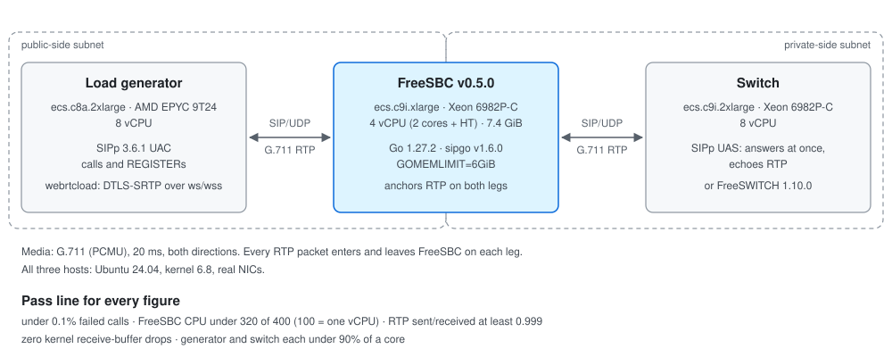
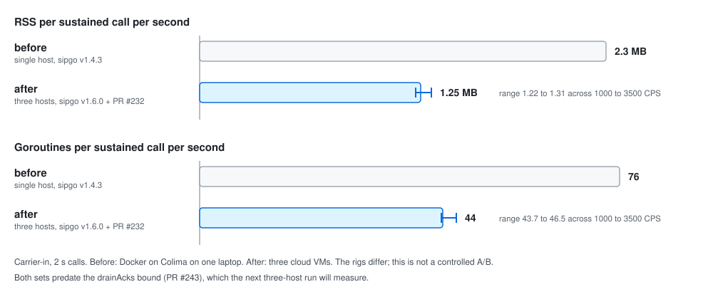

The [first post in this series][prev] ended with a promise: FreeSBC's
capacity numbers would get their own post, with the setup next to them.
Here they are. On one 4 vCPU cloud VM, FreeSBC v0.5.0 relayed
[5000 concurrent G.711 calls with both media legs anchored][sum-media],
set up [3500 calls per second from a carrier without loss][sum-cps], added
[less than 1 ms][sum-latency] to call setup, and ran
[8 hours at 3500 concurrent calls with no growth][sum-soak] in goroutines,
memory, file descriptors or ports.

FreeSBC is a [pure-Go SIP/WebRTC edge proxy: one binary, one YAML file][fsbc-pitch].
It anchors RTP, [does no transcoding][fsbc-media], and
[terminates ICE-Lite and DTLS-SRTP][fsbc-webrtc] for browsers. Every number
below comes from [one formal three-host run][perf-intro] on 2026-10-18 and
2026-10-19, and the harness that produced them is in the repository.

I have not run Kamailio, OpenSIPS, rtpengine or a commercial SBC on the same
rig, so this post does not say FreeSBC is faster than any of them. It gives
numbers in units you can hold against your own: calls per vCPU, call setups
per second on 4 vCPU, added latency, and drift over 8 hours. It also re-runs
one commercial SBC's own published test.

## The numbers

| What | Result on 4 vCPU | Kind |
|---|---|---|
| Concurrent G.711 calls, both legs anchored | [5000, CPU 310 of 400][sum-media] | knee at the 80% CPU line |
| Call setup, carrier to switch | [3500 CPS, loss-free][sum-cps] | knee |
| Call setup, switch to carrier | [3250 CPS][sum-cps] | knee |
| Call setup, client to switch | [2250 CPS or more][sum-cps] | lower bound |
| Latency added to INVITE → 200 | [below 1 ms][sum-latency] | measured |
| 8 h soak at 3500 concurrent calls | [432,000 calls, 0 failed, no growth][sum-soak] | measured |
| Registrations held / refreshed | [19,000 / 20,000 REGISTER/s or more][sum-reg] | lower bound |
| WebRTC, DTLS-SRTP | [100 handshakes/s, 600 calls, or more][sum-webrtc] | lower bound |
| FreeSWITCH 1.10.0 as the switch | [3000 calls, 1500 CPS, or more][sum-fs] | lower bound |

A knee is the last step before the first one that failed the pass line. A
lower bound means
[the generator, the switch or the test range ran out before FreeSBC did][perf-kinds].

## The rig

Three cloud VMs on Alibaba Cloud, [all Ubuntu 24.04 on kernel 6.8, with real
NICs on two subnets of one private network][rig-net]. One subnet plays the
public side, the other the private side. The [instance types][day] and
[CPUs][rig-hosts]:

- **FreeSBC**: ecs.c9i.xlarge, Intel Xeon 6982P-C, 4 vCPU (2 physical cores
  with hyper-threading), 7.4 GiB usable. [v0.5.0, Go 1.27.2, sipgo v1.6.0,
  `GOMEMLIMIT=6GiB`][rig-versions].
- **Load generator**: ecs.c8a.2xlarge, AMD EPYC 9T24, 8 vCPU, running SIPp
  3.6.1 and `webrtcload`, the repository's WebRTC load client.
- **Switch**: ecs.c9i.2xlarge, Xeon 6982P-C, 8 vCPU, running a
  [SIPp UAS that answers at once and echoes RTP][rig-switch], or FreeSWITCH
  1.10.0 for one set of runs.



Signaling is UDP. Media is [G.711 at 20 ms, in both directions, with both
legs anchored by FreeSBC][rig-media], so every RTP packet enters and leaves
FreeSBC on each leg. FreeSBC was [restarted before each ladder value][rig-restart].

A figure only counts if its run had
[under 0.1% failed calls, FreeSBC under 80% of its cores, RTP sent over
received of at least 0.999 with zero kernel receive-buffer errors, and the
generator and the switch each under 90% of a core][rig-pass]. CPU is quoted
with 100 meaning one vCPU, so the line on this box is 320 of 400. The last
check matters most. [SIPp is mostly single-threaded per instance][rig-sipp],
and a fast proxy measured with a saturated generator looks like a slow proxy.

## Media: about 1600 calls per vCPU

The concurrent-call ladder [stepped from 250 to 5500 calls][m02-table],
each with a 60 s ramp and two 60 s holds. CPU grew in a straight line: 20 at
250 calls, 130 at 2000, 251 at 4000. At 5000 calls it was
[310 average and 338 peak][m02-5000], with 500,588 RTP packets per second
each way, 373 MB of RSS and 0 failed calls. That is
[668 Mbit/s each way][m02-mbit]. At 5500 the CPU crossed the line and the
generator's SIPp was at 94% of a core, so the figure is
[5000, or slightly more, generator-bound above][m02-max].

Divided out, that is [about 1600 concurrent calls per vCPU][sizing-media],
and [about 0.07 MB of RSS per call][sizing-mem-call], baseline included.
The per-vCPU figure is arithmetic: only the 4 vCPU size ran this ladder.

The profile at 5000 calls shows where the CPU goes:
[85% cumulative in the forward loop, and about 66 to 70% flat in the
`sendto` and `recvfrom` syscalls][m07-media]. One packet in, one packet
out, one syscall each. GC is not among the top entries. Batching the
syscalls per socket [would save few of them][media-batch], so that issue
was closed as not worth it at this architecture.

## Signaling: thousands of setups per second, under 5 ms

The call-setup ladders [run without media, with 2 s calls, in 40 s steps
from 250 CPS][m01-intro], one per direction. Each knee then got a confirm
run at 90% of it for 120 s.


- **Carrier to switch: 3500 CPS.** CPU averaged
  [190 of 400 at the knee, with 4296 MB of RSS][m01-table]. Calls kept
  succeeding past it: [0.047% failed at 4750 CPS, and the first failing step
  was 5000][m01-carrier-in]. What ends the loss-free range is the kernel
  dropping datagrams on FreeSBC's UDP receive buffers from 3750 CPS, while
  the CPU was at 209 to 265 of 400. That is a receive-path limit, open as
  [#235][i235].
- **Switch to carrier: 3250 CPS.** At 3500 the carrier leg
  [timed out on 0.204% of calls][m01-table].
- **Client to switch: 2250 CPS or more.** This one is a floor. FreeSBC
  [allows 64 unanswered INVITEs per public source IP][early-cap], and the
  generator has one IP. At 2500 CPS [all 248 failures were that cap, with
  FreeSBC at 37% CPU][m01-client].

None of the three knees is a CPU limit:
[FreeSBC averaged 33 to 48% of its CPU at all of them][sum-notes-cpu].
The confirm runs passed every call:
[243,000 at 2025 CPS, 378,000 at 3150 and 351,000 at 2925][m01-confirm],
with INVITE-to-200 p95 under 5 ms at the knees.

FreeSBC's own share of that latency was measured separately at 1000
concurrent calls. INVITE to 200
[averaged 3.0 ms through FreeSBC and 3.0 ms straight to the switch][m02-latency].
The difference is below SIPp's 1 ms resolution.

## It doesn't drift

A proxy that leaks a little per call passes every ladder and fails a week
later. The soak held [3500 concurrent calls, 70% of the media maximum, for
8 hours][m08-cmd]: 15 new calls per second, each held 240 s.
[The results][m08-table]:

- 432,000 calls, 0 failed, 0 retransmissions.
- CPU 235 average, 245 peak, out of 400.
- From the first quarter of the run to the last: goroutines +0.0%, RSS
  −0.3%, open file descriptors +0.0%, ports in use +0.0%. RSS peaked at
  240 MB.
- 10.37 billion RTP packets each way, sent over received 1.0000.
- After the load stopped: 33 goroutines, 13 file descriptors, 0 media
  ports.

The [soak report][soak] has the raw medians: 22,113 goroutines in the first
quarter and 22,113 in the last. No host was reclaimed or rebooted during
the 8 hours.

## A commercial SBC's own test, on one vCPU

One commercial SBC vendor publishes a load test of its own product:
[50 calls per second up to 1000 concurrent calls, each held 600 s][m03-competitor],
on a [Xeon X5670 with 6 cores and 12 threads, 8 GB of RAM and Debian 10][m03-hw].
The published result is "Used Memory 1730M, CPU Load 26%". I am not naming
the vendor. The test is the useful part.

The harness [reproduces that test][m03-cmd]: 2000 calls, G.711 both ways on
both legs, a plateau of about 1180 s. It ran on all four vCPU, then with
FreeSBC limited to two, then to one. [The results][m03-table]:

| FreeSBC cores | Failed | CPU avg / peak (100 = one vCPU) | RSS max | Verdict |
|---|---|---|---|---|
| 4 vCPU | 0 of 2000 | 64 / 70 | 120 MB | PASS |
| 2 | 0 of 2000 | 52 / 57 | 117 MB | PASS |
| 1 | 0 of 2000 | 40 / 44 | 115 MB | PASS |

Probe calls inside the plateau measured
[0.000% loss and 0.47 ms mean jitter][m03-probes]. So one vCPU of this box
carries the vendor's test at 40% of that vCPU. CPU is lower on one core
than on four because [with one core the Go runtime has no idle processors
spinning][m03-spin].

Four caveats before reading more into it:

- I ran FreeSBC. I did not run the vendor's product; its numbers are as
  published.
- The vendor [does not define "CPU Load 26%"][m03-host]: it could be one
  core, all twelve threads, or a load average.
- "Used Memory 1730M" is host memory. The comparable figure is
  [the whole FreeSBC host at 855 MB used][m03-host], not FreeSBC's 120 MB
  RSS. The whole host's CPU averaged 15.9% of its vCPUs.
- The hardware is from different generations. The test plan
  [estimates the two boxes as roughly comparable in total compute, or this
  one somewhat lower][m03-hw]: fewer cores here, each much faster than a
  2010-era Westmere core.

## The 32-second goroutine

The earliest numbers had a problem the three-host run no longer shows. The
first run was a single host, Docker on a laptop, with sipgo v1.4.3. At 2500
CPS [FreeSBC had 189,159 goroutines, and 159,195 of them (84%) sat in one
stack][i170]: sipgo's `TerminateGracefully`, waiting about 32 s for each
finished transaction's timers. That cost about 76 goroutines and 2.3 MB of
RSS per sustained call per second, and at 3500 CPS the process was killed
at its 8 GiB limit.

Two changes removed it. [sipgo v1.6.0][pr231] returns from
`TerminateGracefully` at once for a finished UDP transaction and leaves the
rest to its timers. [PR #232][pr232] stopped ended dialogs from staying
reachable through `OnCancel`, `watch2xx` and backstop timers
([#228][i228]).

On the three-host rig, [RSS came out at 1.22 to 1.31 MB per sustained CPS,
and goroutines at 43.7 to 46.5][c170], flat from 1000 to 3500 CPS. Flat is
the point: the cost is per call, held for a fixed time, and goroutines fall
back to about 33 after each run. It is not a leak. The before and after
come from different rigs, one laptop against three VMs, so this is not a
controlled comparison.



What remains is mostly heap. sipgo keeps each UDP transaction, with its
request and response, for 32 s after a 2xx: Timer L, RFC 6026's Accepted
state. [I left that alone on purpose][perf-timer-l]; it is sipgo's to
change. Of the 44 goroutines per CPS, [31.7 were FreeSBC's own
`drainAcks`][perf-drain-share], waiting the same 32 s for an ACK that
follows a 2xx by one round trip. [PR #243][pr243] bounds that wait at 8 s,
which [cut goroutines per CPS from 32.1 to 8.1 in a local in-process
test][perf-drain]. It landed after the run, so every figure in this post
predates it. The next three-host run will measure it.

## What I am not claiming

- **Other sizes.** [Only 4 vCPU was measured][pend-sizes]; one and two
  vCPU ran only the 1000-call test above. Per-vCPU figures are division.
- **Statistics.** [Each ladder ran once, with one confirm run per
  knee][rig-pass]. There are no confidence intervals.
- **Client call rate.** [2250 CPS is bounded by one source IP][pend-client],
  not by FreeSBC.
- **Carrier-in above 3500 CPS.** The kernel drops datagrams from 3750 CPS
  [while FreeSBC is at 52 to 66% CPU][soak]. The cause is open in
  [#235][i235].
- **Signaling CPU.** [About half is in sipgo's transaction layer, and GC
  takes 20 to 23%][m07-sig]. Allocation per request is open in
  [#173][i173].
- **Untested paths.** [SIP over TCP and TLS, SDES-SRTP, and switch-to-client
  calls were not loaded][pend-paths].
- **Memory at high call rates.** Memory follows calls per second, not
  concurrent calls. [At 5000 CPS carrier-in RSS reached 5.8 GB][sizing-ram]
  on this 7.4 GiB host.
- **Other proxies.** No other open-source SBC or proxy was run on this rig.

## Sizing, and how to rerun it

A rule of thumb for this hardware class, from the
[sizing guide][sizing]:

- **Media**: [about 1600 anchored G.711 calls per vCPU][sizing-media], and
  [about 0.07 MB of RAM per call][sizing-mem-call].
- **Call rate**: [about 1.2 GB of RAM per 1000 sustained CPS, plus
  headroom][sizing-ram]. Set `GOMEMLIMIT` to
  [80 to 90% of the memory the process may use][gomemlimit].
- **Ports**: the default RTP range
  [admits about 5000 calls][ports]; widen it above that.

The kit is in [`test/perf/hosts/`][measure]. [MEASURE.md][measure] defines
each step, its ladder and its pass line, and the
[harness README][harness-hosts] shows how `run.sh` drives three real hosts.
From the generator host, [the commercial SBC's test][m03-cmd], the
[carrier-in ladder][m01-cmd], the [concurrent-call ladder][m02-cmd] and
the [soak][m08-run]:

```sh
cd /opt/freesbc && . test/perf/hosts/env.sh sipp
test/perf/hosts/m03.sh all sipp
test/perf/run.sh -n -s 250:8000:250:40 -H 2 carrier-in
test/perf/hosts/ladder.sh m02 "-c @N@ -H 60 -t 180 -u @N@ call" 250 500 750 1000 1250 1500 2000 2500 3000 4000
test/perf/hosts/m08.sh 3500 8
```

MEASURE.md runs each one detached with `nohup` and judges every run with
`runcheck.sh` and `rigcheck.sh`. For a quick look on a laptop, the
[single-host Docker scenarios][rerun-compose] still work. Their numbers do
not compare with these.

Code: [FreeSBC](https://github.com/rasonyang/freesbc) · [docs/performance.md][perf] · [issue #109](https://github.com/rasonyang/freesbc/issues/109)

[prev]: 

[fsbc-pitch]: https://github.com/rasonyang/freesbc/blob/26f1d9e631249b51097cc65fd5ebfb2444057b7f/README.md#L3-L7
[fsbc-media]: https://github.com/rasonyang/freesbc/blob/26f1d9e631249b51097cc65fd5ebfb2444057b7f/README.md#L114
[fsbc-webrtc]: https://github.com/rasonyang/freesbc/blob/26f1d9e631249b51097cc65fd5ebfb2444057b7f/README.md#L115
[early-cap]: https://github.com/rasonyang/freesbc/blob/26f1d9e631249b51097cc65fd5ebfb2444057b7f/internal/edge/invite.go#L35

[perf]: https://github.com/rasonyang/freesbc/blob/26f1d9e631249b51097cc65fd5ebfb2444057b7f/docs/performance.md
[perf-intro]: https://github.com/rasonyang/freesbc/blob/26f1d9e631249b51097cc65fd5ebfb2444057b7f/docs/performance.md#L3
[perf-kinds]: https://github.com/rasonyang/freesbc/blob/26f1d9e631249b51097cc65fd5ebfb2444057b7f/docs/performance.md#L5
[sum-media]: https://github.com/rasonyang/freesbc/blob/26f1d9e631249b51097cc65fd5ebfb2444057b7f/docs/performance.md#L13
[sum-soak]: https://github.com/rasonyang/freesbc/blob/26f1d9e631249b51097cc65fd5ebfb2444057b7f/docs/performance.md#L14
[sum-cps]: https://github.com/rasonyang/freesbc/blob/26f1d9e631249b51097cc65fd5ebfb2444057b7f/docs/performance.md#L15-L17
[sum-reg]: https://github.com/rasonyang/freesbc/blob/26f1d9e631249b51097cc65fd5ebfb2444057b7f/docs/performance.md#L18
[sum-webrtc]: https://github.com/rasonyang/freesbc/blob/26f1d9e631249b51097cc65fd5ebfb2444057b7f/docs/performance.md#L19
[sum-fs]: https://github.com/rasonyang/freesbc/blob/26f1d9e631249b51097cc65fd5ebfb2444057b7f/docs/performance.md#L20
[sum-latency]: https://github.com/rasonyang/freesbc/blob/26f1d9e631249b51097cc65fd5ebfb2444057b7f/docs/performance.md#L21
[sum-notes-cpu]: https://github.com/rasonyang/freesbc/blob/26f1d9e631249b51097cc65fd5ebfb2444057b7f/docs/performance.md#L24
[media-batch]: https://github.com/rasonyang/freesbc/blob/26f1d9e631249b51097cc65fd5ebfb2444057b7f/docs/performance.md#L25
[sizing]: https://github.com/rasonyang/freesbc/blob/26f1d9e631249b51097cc65fd5ebfb2444057b7f/docs/performance.md#L27-L45
[sizing-media]: https://github.com/rasonyang/freesbc/blob/26f1d9e631249b51097cc65fd5ebfb2444057b7f/docs/performance.md#L33
[sizing-mem-call]: https://github.com/rasonyang/freesbc/blob/26f1d9e631249b51097cc65fd5ebfb2444057b7f/docs/performance.md#L36
[ports]: https://github.com/rasonyang/freesbc/blob/26f1d9e631249b51097cc65fd5ebfb2444057b7f/docs/performance.md#L40
[sizing-ram]: https://github.com/rasonyang/freesbc/blob/26f1d9e631249b51097cc65fd5ebfb2444057b7f/docs/performance.md#L42
[perf-drain-share]: https://github.com/rasonyang/freesbc/blob/26f1d9e631249b51097cc65fd5ebfb2444057b7f/docs/performance.md#L51-L54
[perf-drain]: https://github.com/rasonyang/freesbc/blob/26f1d9e631249b51097cc65fd5ebfb2444057b7f/docs/performance.md#L57
[perf-timer-l]: https://github.com/rasonyang/freesbc/blob/26f1d9e631249b51097cc65fd5ebfb2444057b7f/docs/performance.md#L58
[gomemlimit]: https://github.com/rasonyang/freesbc/blob/26f1d9e631249b51097cc65fd5ebfb2444057b7f/docs/performance.md#L62
[rig-net]: https://github.com/rasonyang/freesbc/blob/26f1d9e631249b51097cc65fd5ebfb2444057b7f/docs/performance.md#L70
[rig-hosts]: https://github.com/rasonyang/freesbc/blob/26f1d9e631249b51097cc65fd5ebfb2444057b7f/docs/performance.md#L72-L76
[rig-versions]: https://github.com/rasonyang/freesbc/blob/26f1d9e631249b51097cc65fd5ebfb2444057b7f/docs/performance.md#L78
[rig-switch]: https://github.com/rasonyang/freesbc/blob/26f1d9e631249b51097cc65fd5ebfb2444057b7f/docs/performance.md#L79
[rig-media]: https://github.com/rasonyang/freesbc/blob/26f1d9e631249b51097cc65fd5ebfb2444057b7f/docs/performance.md#L80
[rig-pass]: https://github.com/rasonyang/freesbc/blob/26f1d9e631249b51097cc65fd5ebfb2444057b7f/docs/performance.md#L81
[rig-restart]: https://github.com/rasonyang/freesbc/blob/26f1d9e631249b51097cc65fd5ebfb2444057b7f/docs/performance.md#L82
[m03-table]: https://github.com/rasonyang/freesbc/blob/26f1d9e631249b51097cc65fd5ebfb2444057b7f/docs/performance.md#L88-L94
[m03-probes]: https://github.com/rasonyang/freesbc/blob/26f1d9e631249b51097cc65fd5ebfb2444057b7f/docs/performance.md#L96
[m03-spin]: https://github.com/rasonyang/freesbc/blob/26f1d9e631249b51097cc65fd5ebfb2444057b7f/docs/performance.md#L97
[m03-host]: https://github.com/rasonyang/freesbc/blob/26f1d9e631249b51097cc65fd5ebfb2444057b7f/docs/performance.md#L98
[m01-intro]: https://github.com/rasonyang/freesbc/blob/26f1d9e631249b51097cc65fd5ebfb2444057b7f/docs/performance.md#L100-L102
[m01-table]: https://github.com/rasonyang/freesbc/blob/26f1d9e631249b51097cc65fd5ebfb2444057b7f/docs/performance.md#L104-L108
[m01-client]: https://github.com/rasonyang/freesbc/blob/26f1d9e631249b51097cc65fd5ebfb2444057b7f/docs/performance.md#L110
[m01-carrier-in]: https://github.com/rasonyang/freesbc/blob/26f1d9e631249b51097cc65fd5ebfb2444057b7f/docs/performance.md#L111
[m01-confirm]: https://github.com/rasonyang/freesbc/blob/26f1d9e631249b51097cc65fd5ebfb2444057b7f/docs/performance.md#L113
[m02-table]: https://github.com/rasonyang/freesbc/blob/26f1d9e631249b51097cc65fd5ebfb2444057b7f/docs/performance.md#L125-L137
[m02-5000]: https://github.com/rasonyang/freesbc/blob/26f1d9e631249b51097cc65fd5ebfb2444057b7f/docs/performance.md#L127-L136
[m02-max]: https://github.com/rasonyang/freesbc/blob/26f1d9e631249b51097cc65fd5ebfb2444057b7f/docs/performance.md#L139
[m02-mbit]: https://github.com/rasonyang/freesbc/blob/26f1d9e631249b51097cc65fd5ebfb2444057b7f/docs/performance.md#L140
[m02-latency]: https://github.com/rasonyang/freesbc/blob/26f1d9e631249b51097cc65fd5ebfb2444057b7f/docs/performance.md#L141
[m07-sig]: https://github.com/rasonyang/freesbc/blob/26f1d9e631249b51097cc65fd5ebfb2444057b7f/docs/performance.md#L177
[m07-media]: https://github.com/rasonyang/freesbc/blob/26f1d9e631249b51097cc65fd5ebfb2444057b7f/docs/performance.md#L178
[m08-cmd]: https://github.com/rasonyang/freesbc/blob/26f1d9e631249b51097cc65fd5ebfb2444057b7f/docs/performance.md#L185
[m08-table]: https://github.com/rasonyang/freesbc/blob/26f1d9e631249b51097cc65fd5ebfb2444057b7f/docs/performance.md#L187-L197
[rerun-compose]: https://github.com/rasonyang/freesbc/blob/26f1d9e631249b51097cc65fd5ebfb2444057b7f/docs/performance.md#L246-L260
[pend-client]: https://github.com/rasonyang/freesbc/blob/26f1d9e631249b51097cc65fd5ebfb2444057b7f/docs/performance.md#L273
[pend-paths]: https://github.com/rasonyang/freesbc/blob/26f1d9e631249b51097cc65fd5ebfb2444057b7f/docs/performance.md#L277
[pend-sizes]: https://github.com/rasonyang/freesbc/blob/26f1d9e631249b51097cc65fd5ebfb2444057b7f/docs/performance.md#L279

[measure]: https://github.com/rasonyang/freesbc/blob/26f1d9e631249b51097cc65fd5ebfb2444057b7f/test/perf/hosts/MEASURE.md
[m03-hw]: https://github.com/rasonyang/freesbc/blob/26f1d9e631249b51097cc65fd5ebfb2444057b7f/test/perf/hosts/MEASURE.md#L18-L22
[rig-sipp]: https://github.com/rasonyang/freesbc/blob/26f1d9e631249b51097cc65fd5ebfb2444057b7f/test/perf/hosts/MEASURE.md#L68-L70
[m03-competitor]: https://github.com/rasonyang/freesbc/blob/26f1d9e631249b51097cc65fd5ebfb2444057b7f/test/perf/hosts/MEASURE.md#L135-L137
[m03-cmd]: https://github.com/rasonyang/freesbc/blob/26f1d9e631249b51097cc65fd5ebfb2444057b7f/test/perf/hosts/MEASURE.md#L153-L160
[m01-cmd]: https://github.com/rasonyang/freesbc/blob/26f1d9e631249b51097cc65fd5ebfb2444057b7f/test/perf/hosts/MEASURE.md#L210
[m02-cmd]: https://github.com/rasonyang/freesbc/blob/26f1d9e631249b51097cc65fd5ebfb2444057b7f/test/perf/hosts/MEASURE.md#L245-L247
[m08-run]: https://github.com/rasonyang/freesbc/blob/26f1d9e631249b51097cc65fd5ebfb2444057b7f/test/perf/hosts/MEASURE.md#L423-L424
[harness-hosts]: https://github.com/rasonyang/freesbc/blob/26f1d9e631249b51097cc65fd5ebfb2444057b7f/test/perf/README.md#L313-L340

[day]: https://github.com/rasonyang/freesbc/issues/109#issuecomment-6249040280
[soak]: https://github.com/rasonyang/freesbc/issues/109#issuecomment-6256238968
[i170]: https://github.com/rasonyang/freesbc/issues/170
[c170]: https://github.com/rasonyang/freesbc/issues/170#issuecomment-6249485186
[i173]: https://github.com/rasonyang/freesbc/issues/173
[i228]: https://github.com/rasonyang/freesbc/issues/228
[i235]: https://github.com/rasonyang/freesbc/issues/235
[pr231]: https://github.com/rasonyang/freesbc/pull/231
[pr232]: https://github.com/rasonyang/freesbc/pull/232
[pr243]: https://github.com/rasonyang/freesbc/pull/243
